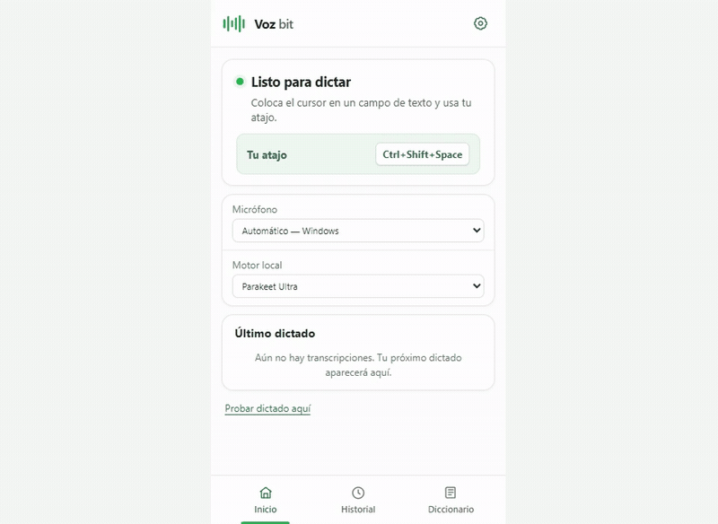
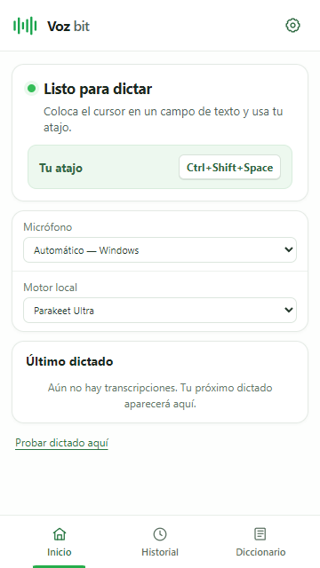
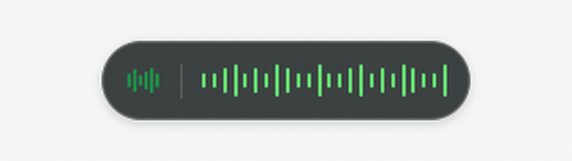
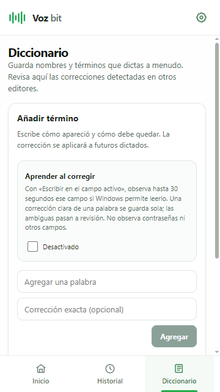
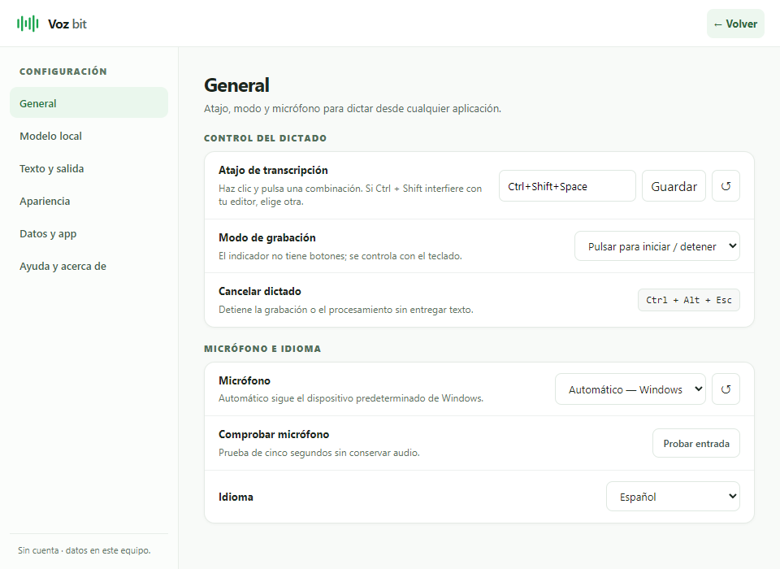

<div align="center">
  

  # Vozbit

  **Dicta en cualquier aplicación de Windows y recibe texto listo para usar.**

  [](https://github.com/yordy-dev/vozbit/releases/latest)
  
  

  [**Descargar Vozbit**](https://github.com/yordy-dev/vozbit/releases/latest) · [Ver todas las versiones](https://github.com/yordy-dev/vozbit/releases) · [Reportar un problema](https://github.com/yordy-dev/vozbit/issues/new)
</div>



<div align="center">
  <a href="docs/media/vozbit-demo.mp4">Ver la demostración en video</a>
</div>

## ¿Qué es Vozbit?

Vozbit es una aplicación de dictado local para Windows. Convierte tu voz en texto y lo entrega en el campo donde estás escribiendo: chats, documentos, formularios o editores de código. No requiere una cuenta y los motores de transcripción se ejecutan en tu equipo.

## ¿Para qué puedes usarlo?

- **Mensajes y documentos:** dicta párrafos sin cambiar de aplicación.
- **Código y contenido técnico:** usa el diccionario personal para nombres, comandos y términos frecuentes.
- **Apuntes y trabajo diario:** recupera dictados anteriores desde el historial local.
- **Ecuaciones y números:** activa el formato de números y símbolos matemáticos para expresiones dictadas.
- **Palabras propias:** enseña correcciones manualmente o permite que Vozbit detecte cambios claros después de un dictado.

## Así se ve Vozbit

| Inicio compacto | Indicador durante el dictado |
| --- | --- |
|  |  |
| **Diccionario personal** | **Configuración organizada** |
|  |  |

## Cómo se usa

1. **Coloca el cursor.** Haz clic en el campo donde quieres recibir el texto.
2. **Activa el dictado.** Pulsa `Ctrl + Shift + Space` o el atajo que hayas configurado.
3. **Habla con normalidad.** El indicador verde confirma que Vozbit está escuchando.
4. **Finaliza el dictado.** Vuelve a usar el atajo; la onda naranja muestra el procesamiento local.
5. **Recibe el texto.** Vozbit intenta entregarlo en el campo activo y conserva el resultado en Inicio si Windows no permite confirmar el destino.

## Ventajas

| Ventaja | Qué significa para ti |
| --- | --- |
| Transcripción local | El audio se procesa en tu computadora con Parakeet Ultra o Whisper base. |
| Sin cuenta | Puedes instalar y usar Vozbit sin registro. |
| Uso global | El atajo funciona mientras trabajas en otras aplicaciones compatibles. |
| Interfaz compacta | La ventana principal ocupa poco espacio y Configuración se amplía solo cuando la necesitas. |
| Recuperación | El último resultado y el historial local permiten recuperar texto si la entrega falla. |
| Diccionario personal | Puedes guardar términos propios y revisar correcciones aprendidas. |

## Funciones principales

### Dictado y entrega

- Atajo global configurable, con modo pulsar o mantener presionado.
- Selección de micrófono e idioma desde la aplicación.
- Entrega al campo de texto activo mediante funciones locales de Windows.
- Indicador flotante para grabación, procesamiento, finalización y errores.
- Reprocesamiento del último audio y copia manual desde Inicio.

### Transcripción y formato

- Parakeet Ultra y Whisper base como motores locales seleccionables.
- Detección de voz con Silero VAD.
- Corrección de texto, espacio final y formato de números configurables.
- Conversión opcional de expresiones matemáticas dictadas a símbolos.

### Historial y diccionario

- Historial local con búsqueda, favoritos y límite configurable.
- Diccionario de términos y reemplazos personalizados.
- Aprendizaje opcional de correcciones realizadas después del dictado.
- Revisión de sugerencias ambiguas antes de convertirlas en reglas permanentes.

## Descargar y empezar

1. Descarga la [versión más reciente](https://github.com/yordy-dev/vozbit/releases/latest).
2. Ejecuta `Vozbit_0.5.8_x64-setup.exe`.
3. Abre Vozbit y completa el tutorial inicial.
4. Elige el micrófono y el motor local en **Configuración**.
5. Coloca el cursor en un campo de texto y pulsa `Ctrl + Shift + Space`.

> [!NOTE]
> El instalador incluye los motores, los modelos locales y WebView2 para funcionar sin descargas adicionales durante la instalación. Por eso el archivo ocupa aproximadamente 1 GB.

> [!WARNING]
> El instalador actual no tiene firma digital. Windows puede mostrar una advertencia de editor desconocido. Descárgalo únicamente desde este repositorio y compara su SHA-256 con [`SHA256SUMS-v0.5.8.txt`](SHA256SUMS-v0.5.8.txt).

## Requisitos y compatibilidad

- Windows 10 u 11 de 64 bits.
- Micrófono reconocido por Windows.
- Aproximadamente 2 GB libres para la instalación y los archivos temporales.
- Más memoria y CPU disponibles mejoran la velocidad de los modelos locales.

Vozbit no ofrece actualmente versiones para macOS o Linux.

## Privacidad

Vozbit no requiere una cuenta. Whisper y Parakeet procesan el audio localmente y el audio temporal se elimina al terminar. El historial guarda texto en el equipo y puede desactivarse. El aprendizaje de correcciones también es opcional y no observa campos de contraseña.

<details>
<summary><strong>Desarrollo local</strong></summary>

### Preparación

Se requieren Node.js, Rust y los prerrequisitos de escritorio de Tauri para Windows.

Descarga y verifica los modelos fijados para el proyecto:

```powershell
.\scripts\fetch-models.ps1
```

Instala las dependencias y ejecuta el frontend:

```powershell
cd app
npm ci
npm run dev
```

### Compilación

```powershell
cd app
npm run build
npm run tauri -- build --bundles nsis
```

Los modelos grandes se distribuyen como recursos de las [Releases](https://github.com/yordy-dev/vozbit/releases). `fetch-models.ps1` descarga las versiones fijadas y comprueba sus hashes SHA-256.

### Recursos del README

- Capturas: `docs/images/`
- GIF y videos: `docs/media/`

</details>

## Solución de problemas

- **No se oye el dictado:** revisa el micrófono elegido y los permisos de micrófono de Windows.
- **El atajo no responde:** comprueba que otra aplicación no use la misma combinación.
- **El texto no aparece en el campo:** revisa el modo de entrega; el resultado permanece disponible en Inicio para copiarlo.
- **El motor local no está listo:** vuelve a comprobar sus archivos desde Configuración o ejecuta `fetch-models.ps1` al compilar desde el código.
- **La transcripción tarda:** Parakeet Ultra prioriza precisión y puede necesitar más tiempo en equipos con menos CPU o memoria disponible.

## Ayuda y contribución

Si encuentras un error, [abre una incidencia](https://github.com/yordy-dev/vozbit/issues/new) e incluye:

- Versión de Vozbit y de Windows.
- Motor de transcripción seleccionado.
- Pasos exactos para reproducir el problema.
- Resultado esperado y resultado obtenido.
- Captura o video, siempre que no exponga información privada.

## Componentes y licencia

Los motores y modelos de terceros conservan sus propias licencias y atribuciones, incluidas en `app/src-tauri/resources/THIRD_PARTY_LICENSES.txt` y en los recursos correspondientes. El código de Vozbit está visible públicamente, pero todavía no tiene una licencia general de reutilización.
